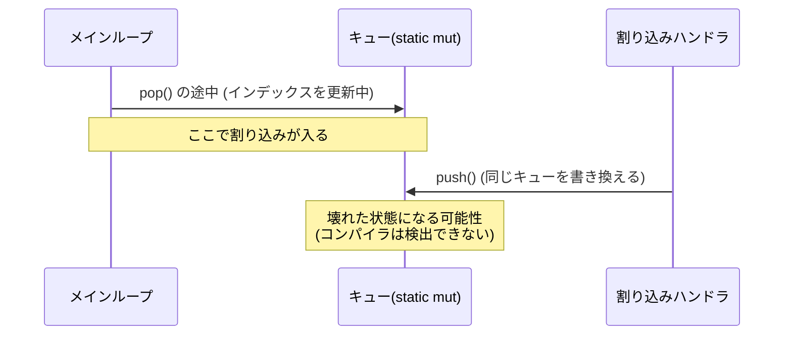
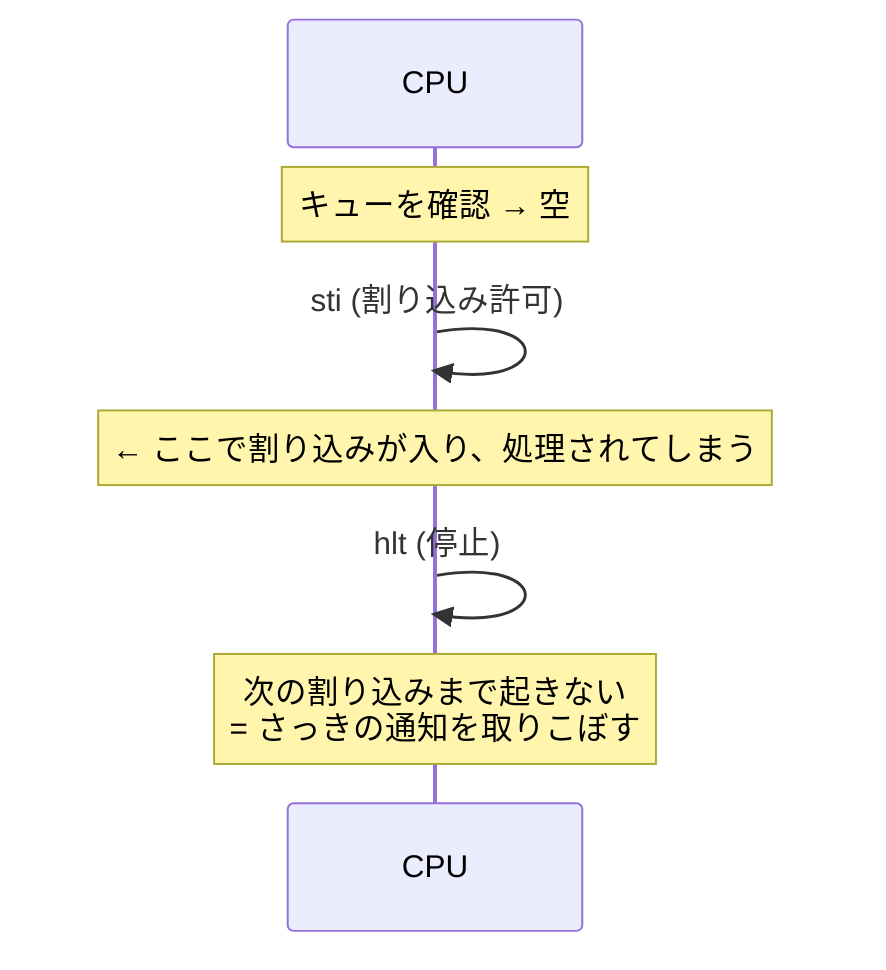

# 今回の変更点の解説（Rust 初心者向け）

今回行った変更を、「**何が問題だったか → どう直したか → どんな効果があるか**」の順で説明します。
コードは Before / After で示します（説明用に簡略化しています）。

変更は大きく 4 つです。

1. [C++ の USB ドライバの整理（`kernel/cpp/`）](#1-c-の-usb-ドライバの整理)
2. [`static mut` を `Global<T>` に置き換え](#2-static-mut-を-globalt-に置き換え)
3. [メインループを `hlt` 待ちに変更](#3-メインループを-hlt-待ちに変更)
4. [`layer.rs` の作り直し（生ポインタの排除）](#4-layerrs-の作り直し生ポインタの排除)

おまけとして [小さな修正](#5-小さな修正) も載せます。

---

## 前提知識：Rust の「安全」とは

Rust は、コンパイラが次のようなバグを**コンパイル時に防ぐ**言語です。

- 同じデータを **同時に 2 か所から書き換える**（データ競合）
- すでに**無効になったメモリを使う**（ダングリングポインタ）

ただし `unsafe { ... }` と書いた部分では、この検査が**止まります**。
「ここは人間が責任を持つ」という宣言です。`unsafe` が多いほど、バグが起きたときの調査範囲が広くなります。

今回の変更の多くは、**「`unsafe` を減らして、コンパイラに守ってもらう」**ためのものです。

---

## 1. C++ の USB ドライバの整理

### 元の設計の問題

- USB ドライバは C++ 製（本家 MikanOS の作者のコード）で、Rust から直接使えません。
- そのため `usb_wrapper/` に**橋渡しコード**を作っていましたが、次の問題がありました。
  - **本家の初期化処理をコピーして書き直していた**（`usb_enumarate` の中身）。本家が更新されても追従できません。
  - `kernel/` の直下に `.cpp` / `.hpp` / `.o` が散らばっていました。
  - 同じ名前のファイルが複数あり（例: `register.hpp` が 2 つ）、**内容が違う**ので、どちらが使われるか分かりにくい状態でした。
  - 関数名が独自（`usb_enumarate`、`usb_set_mouse_obserever` など）で、本家のコードと対応が取れませんでした。
  - マウスのコールバックの型が本家（3 引数）と合っていませんでした（2 引数）。

### 変更内容

```
kernel/
├── src/
│   ├── pci.rs          ← 新規: pci:: の Rust 側の入り口
│   └── usb/mod.rs      ← 新規: usb:: の Rust 側の入り口
└── cpp/                ← C++ はすべてここに集約
    ├── usb/            ← 本家のドライバ（無改造）
    ├── pci.cpp, error.hpp, register.hpp ... ← 本家のものに統一
    ├── bridge/rust_bridge.cpp ← Rust から呼ぶ薄い橋渡し
    └── makefile        ← libmikan_usb.a を作る
```

**効果・意図**

- **本家の関数をそのまま呼ぶ**ようにしました。本家の `usb::xhci::Initialize()` は、xHC の探索から初期化、MSI 設定、ポート設定までを全部やってくれます。独自の複製は不要でした。
- Rust 側も本家と同じ名前にしたので、本家のコードを読みながら対応が取れます。

```rust
// Before: 独自名・独自実装
usb_set_mouse_obserever(moverelative);   // 引数 2 個
usb_enumarate();

// After: 本家と同じ名前
pci::ScanAllBus();
usb::HIDMouseDriver::set_default_observer(MouseObserver);   // 引数 3 個 (buttons, dx, dy)
usb::xhci::Initialize();
```

### Rust 初心者向けメモ：`extern "C"` と FFI

Rust から C/C++ の関数を呼ぶ仕組みを **FFI** と呼びます。

```rust
unsafe extern "C" {
    fn usb_xhci_Initialize();      // C++ 側にある関数の「宣言」だけを書く
}

pub fn Initialize() {
    unsafe { usb_xhci_Initialize() }   // 呼ぶときは unsafe が必要
}
```

- C++ の関数を Rust が直接呼ぶことはできないので、C++ 側に `extern "C"` の関数（`rust_bridge.cpp`）を用意しています。
- `unsafe` は「C++ 側が正しく動く保証は Rust にはできない」という意味です。
- そこで、`unsafe` を **`usb/mod.rs` の中に閉じ込め**、使う側（`main.rs`）は普通の関数として呼べるようにしました。**危険な部分を 1 か所に集める**のは安全な設計の基本です。

---

## 2. `static mut` を `Global<T>` に置き換え

### 元の設計の問題

グローバル変数が `static mut`（変更可能な静的変数）で、**9 か所**ありました。

```rust
// Before
pub static mut INTERRUPTMESSAGE_QUEUE: Queue<InterruptMessage> = Queue::new();

// 使うたびに、こう書く必要があった
unsafe {
    let q = &mut *addr_of_mut!(INTERRUPTMESSAGE_QUEUE);
    q.push(...);
}
```

何が危険かを、このカーネルの場合で説明します。



- メインループと割り込みハンドラは**同じキューを触ります**。割り込みはいつでも入るので、`pop` の途中で `push` が割り込むとデータが壊れかねません。
- 以前は `asm!("cli")` / `asm!("sti")`（割り込みの禁止/許可）を**手書き**して防いでいました。しかし書き忘れても**コンパイラは何も言いません**。
- `static mut` への `&mut` 参照は、Rust 2024 では警告・エラーの対象です。「同時に複数の `&mut` ができて未定義動作になりうる」ためです。

### 変更内容：`Global<T>`（`global.rs`）

```rust
// After
pub static INTERRUPTMESSAGE_QUEUE: Global<Queue<InterruptMessage>> = Global::new(Queue::new());

// 使う側: unsafe が要らない
INTERRUPTMESSAGE_QUEUE.with(|q| q.push(InterruptMessage::InterruptXhci));
```

`Global<T>` の中身（簡略版）:

```rust
pub struct Global<T> {
    value: UnsafeCell<T>,   // 中身。UnsafeCell は「共有されていても書き換えてよい」ための箱
    busy: Cell<bool>,       // 今だれかが使っているか
}

pub fn with<R>(&self, f: impl FnOnce(&mut T) -> R) -> R {
    without_interrupts(|| {                       // ① 割り込みを禁止
        assert!(!self.busy.get(), "re-entrant");  // ② 二重利用ならパニック
        self.busy.set(true);
        let r = f(unsafe { &mut *self.value.get() });  // ③ 中身を &mut で貸す
        self.busy.set(false);
        r
    })                                            // ④ 終わったら割り込み状態を元に戻す
}
```

**効果・意図**

| 問題 | 解決方法 |
|---|---|
| 割り込みとの競合 | `with` の間は自動で割り込み禁止。**書き忘れが起きない** |
| 同時に 2 つの `&mut` ができる | `busy` フラグで二重利用を検出し、**黙って壊れる代わりにパニック**させる |
| あちこちに `unsafe` | `unsafe` を `Global` の中の 1 か所に集約。使う側は安全なコード |

### Rust 初心者向けメモ

- **`|q| q.push(...)`** は**クロージャ**（無名関数）です。`with` が「中身を貸すから、この処理をして」と受け取って実行します。`q` が中身への `&mut` です。
- **`&mut T`** は「唯一の書き込み可能な参照」です。同時に 2 つ存在してはいけない、というのが Rust の最重要ルールの 1 つです。
- `with` の外へ `&mut T` を持ち出せない（クロージャが終わると参照も消える）ため、**借りっぱなしにするミスも防げます**。

### 置き換えた対象

`IDT`、`GDT`、ページテーブル 3 種、`MEMORY_MANAGER`、`MOUSE_CURSOR`、割り込みキュー、`CONSOLE`、`LAYER_MANAGER`。

### 注意点（制約）

- **同じ `Global` を `with` の中でもう一度 `with` するとパニック**します。例: `CONSOLE.with(...)` の中から `printk!` を呼ぶ。
- `with` の間は割り込みが止まるので、**重い処理を入れすぎない**ようにします（USB の応答が遅れます）。
- シングルコア専用です。マルチコアにするならスピンロックに変更が必要です。

### GDT / IDT だけ `init_static` を使う理由

GDT や IDT は、CPU が**ずっと**参照し続けるテーブルです。`load()` が `&'static`（プログラム終了まで有効な参照）を要求します。

```rust
IDT.init_static(|idt| {            // 'static な &mut を渡す (初期化時に 1 回だけ使う)
    idt[0x40].set_handler_fn(handler);
    idt.load();
});
```

`with` では借りた参照がクロージャの終了で消えるため、`'static` を要求する `load()` に渡せません。そのため初期化専用の `init_static` を別に用意しました。

### `CONSOLE` の変更

```rust
// Before: Box を生ポインタに変換して static mut に保存
static mut CONSOLE: *mut Console<'static> = core::ptr::null_mut();
CONSOLE = Box::into_raw(Box::new(console));          // unsafe
if !console.is_null() { (&mut *console).write_fmt(args); }   // null チェックを自分で

// After: Option で「あるかないか」を表す
static CONSOLE: Global<Option<Console<'static>>> = Global::new(None);
CONSOLE.with(|c| *c = Some(console));
CONSOLE.with(|c| if let Some(console) = c { console.write_fmt(args); });
```

**意図**: 生ポインタ（`*mut T`）と null チェックは、チェック忘れで即クラッシュします。`Option<T>`（`Some(値)` か `None`）なら、**`None` の場合を処理しないとコンパイルが通りません**。

---

## 3. メインループを `hlt` 待ちに変更

### 元の設計の問題

```rust
// Before
asm!("cli");                        // 割り込み禁止
if let Some(msg) = q.pop() {
    asm!("sti");
    ...処理...
} else {
    // asm!("sti\n\thlt");          ← コメントアウトされていた
    asm!("sti");
    continue;                       // すぐ最初に戻る = 休まず回り続ける
}
```

- メッセージがなくても**全速力でループを回り続ける**（ビジーループ）ので、CPU を無駄に使い続けていました。
- `cli`/`sti` を `asm!` で手書きしていました（`unsafe`、書き忘れ検出なし）。

### 変更内容

```rust
// After
x86_64::instructions::interrupts::disable();               // cli
let msg = INTERRUPTMESSAGE_QUEUE.with(|q| q.pop());
match msg {
    Some(InterruptMessage::InterruptXhci) => {
        x86_64::instructions::interrupts::enable();         // sti
        usb::xhci::ProcessEvents();
    }
    None => x86_64::instructions::interrupts::enable_and_hlt(),   // sti; hlt
}
```

**効果**

- メッセージがないときは `hlt`（CPU 停止、次の割り込みで再開）で**待機**します。CPU 使用率が大きく下がります。
- `asm!` の手書きをやめ、`x86_64` クレートの安全な関数に置き換えました。

### なぜ `enable_and_hlt()`（`sti; hlt` 一体）なのか

もし `sti` と `hlt` を別々に書くと、次のバグが起きます。



x86 CPU には「**`sti` の直後の 1 命令は割り込まれない**」という決まりがあります。そのため `sti; hlt` を続けて実行すれば、確認から待機までの間に**割り込みが入る隙間がありません**。`enable_and_hlt()` はこれを 1 つの関数にしたものです。

### 見た目の変化

画面中央の数字（カウンタ）は、以前は全速力で増えていました。今は**割り込みが来たときだけ**増えます（マウスを動かすと増えます）。本家 MikanOS と同じ挙動です。

---

## 4. `layer.rs` の作り直し（生ポインタの排除）

### 元の設計の問題

```rust
// Before
pub struct LayerManager {
    layers: Vec<Box<Layer>>,
    layer_stack: Vec<*mut Layer>,   // ← 生ポインタ
    screen: *mut FrameBuffer,       // ← 生ポインタ
    back_buffer: FrameBuffer,
}
```

さらに main.rs 側で:

```rust
static mut LAYER_MANAGER: *mut LayerManager = null_mut();   // main() のローカル変数を指す
static mut FRAME_BUFFER: *mut FrameBuffer = null_mut();     // 同上
// ...
LAYER_MANAGER = &mut layer_manager;   // ローカル変数のアドレスを保存
```

**何がダメか**

1. **`*mut Layer`（生ポインタ）は、指す先が有効か誰も保証しません。**
   `layers` の `Vec` が増えたり、`Box` が消えたりしても、ポインタは古いまま残ります（ダングリングポインタ）。たまたま今は動いていただけです。
2. **ローカル変数のアドレスを `static` に保存**していました。`KernelMainNewStack` は `-> !`（戻らない関数）なので、たまたま問題が出ませんでしたが、**関数が終わる設計に変えた瞬間に壊れます**。
3. `screen` が別の持ち主（`frame_buffer` ローカル）の所有物で、`LayerManager` と**二重管理**になっていました。誰がいつ解放するのか、型から分かりません。
4. 描画コードは `unsafe` だらけで、検査が効かない範囲が広くなっていました。

### 変更内容

```rust
// After
pub struct LayerManager {
    layers: Vec<Box<Layer>>,
    layer_stack: Vec<u32>,        // ポインタではなくレイヤー ID
    screen: FrameBuffer,          // 所有する (ポインタをやめた)
    back_buffer: FrameBuffer,
}

pub static LAYER_MANAGER: Global<Option<LayerManager>> = Global::new(None);
```

**1) 生ポインタ → ID にした**

```rust
// Before: ポインタを直接たどる (unsafe)
for &l in &self.layer_stack {
    let layer = unsafe { &*l };
    ...
}

// After: ID で layers から探す (unsafe 不要)
for id in &self.layer_stack {
    if let Some(layer) = self.layers.iter().find(|l| l.id == *id) {
        ...
    }
}
```

- **意図**: ID は「番号」にすぎないので、指す先が消えても**メモリ破壊は起きず**、見つからなければ `None` になるだけです。
- **トレードオフ**: ID から毎回探す（線形検索）ため少し遅くなります。レイヤー数は数個なので、実用上は無視できます。数が増えたら `HashMap` や ID をそのまま添字にする `Vec` に変更できます。

**2) 並べ替えも安全に**

```rust
// Before: ポインタから z を読んでソート (unsafe)
self.layer_stack.sort_by_key(|&ptr| unsafe { (*ptr).z });

// After: (z, id) の組を作ってソート
let mut visible: Vec<(i32, u32)> = self.layers.iter().filter(|l| l.z >= 0).map(|l| (l.z, l.id)).collect();
visible.sort_by_key(|&(z, _)| z);
self.layer_stack = visible.into_iter().map(|(_, id)| id).collect();
```

**3) `screen` を所有に**

```rust
// Before
let mut frame_buffer = FrameBuffer::new(config);
let mut layer_manager = LayerManager::new(addr_of_mut!(frame_buffer));   // ポインタを渡す

// After
let frame_buffer = FrameBuffer::new(config);
let mut layer_manager = LayerManager::new(frame_buffer);                  // 所有権を渡す (move)
```

- **Rust 初心者向けメモ（所有権）**: Rust では値の持ち主が 1 人に決まっていて、渡すと元の変数は使えなくなります（**move**）。`frame_buffer` を `LayerManager` に渡した後は、`LayerManager` だけが持ち主です。誰がいつ解放するかが型で決まり、**二重管理が消えます**。

**4) グローバル化は `Global<Option<...>>` で**

```rust
// Before: ローカル変数のアドレスを static に保存
LAYER_MANAGER = &mut layer_manager;

// After: 所有権ごと static に移す
LAYER_MANAGER.with(|lm| *lm = Some(layer_manager));
```

- ローカル変数が消えてもダングリングになりません（実体が static 側にあるため）。

**5) マウスカーソルもポインタをやめた**

```rust
// Before: MouseCursor が *mut LayerManager を持っていた
cursor.init(&mut layer_manager, id, size, redraw, redraw_area);
(*layer_manager).move_layer(...)       // unsafe

// After: 必要なときに LAYER_MANAGER を借りる
LAYER_MANAGER.with(|lm| {
    if let Some(lm) = lm { lm.move_layer(self.layer_id, self.position); }
});
```

**6) `draw_id` の不具合修正**

```rust
// Before: ループの「中」で毎回 画面にコピーしていた
for &l in &self.layer_stack {
    ...
    (&mut *self.screen).copy_area(&window_area, &self.back_buffer);   // 毎周実行
}

// After: ループの「後」に 1 回だけ (描画対象が見つかった場合のみ)
if draw { self.screen.copy_area(&window_area, &self.back_buffer); }
```

- 対象より背面のレイヤーの周回でも、未完成のバックバッファを画面にコピーしていました。無駄なコピーと、ちらつきの原因になりえます。

### 描画関数の変更点

```rust
// Before: 生ポインタをたどって描画
pub fn redraw_layers_all() {
    unsafe {
        if !LAYER_MANAGER.is_null() && !FRAME_BUFFER.is_null() {
            (*LAYER_MANAGER).draw_all();
        }
    }
}

// After: 初期化前は何もしない、が Option で表現できる
pub fn redraw_layers_all() {
    LAYER_MANAGER.with(|lm| {
        if let Some(lm) = lm { lm.draw_all(); }
    });
}
```

---

## 5. 小さな修正

| 変更 | 理由 |
|---|---|
| `Rectrange` → `Rectangle` | スペルミスの修正（全ファイル） |
| `BitMapMamoryManager` → `BitMapMemoryManager` | 同上 |
| 未使用 `import` を `cargo fix` で削除 | 警告の削減（53 → 26 件） |
| `MemoryType` / `PixelFormat` に `#[allow(non_camel_case_types)]` | `kEfi...` など**本家 MikanOS と名前を揃える**ためにあえて残しているので、警告だけ消した |
| 不要になった `unsafe` ブロックを削除 | `unsafe` は本当に必要な場所だけに |
| `build.rs` のリンク先を `cpp/libmikan_usb.a` に変更 | C++ の移動に伴う変更 |
| `build_and_runOS.sh` の `make` 実行先を `kernel/cpp` に変更 | 同上 |
| `.gitignore` から `kernel/usb/*` などを削除 | 整理後はこれらを管理対象にするため |

---

## まとめ：変更前後の比較

| 観点 | 変更前 | 変更後 |
|---|---|---|
| グローバル変数 | `static mut` 9 か所、使うたびに `unsafe` | `Global<T>` に統一、使う側は安全 |
| 割り込みとの競合 | `cli`/`sti` を手書き（忘れても検出されない） | `with` が自動で割り込み禁止 |
| 二重借用 | 検出不可（未定義動作） | パニックで検出 |
| レイヤー管理 | 生ポインタ（ダングリングの危険） | ID と所有権（`unsafe` なし） |
| 画面バッファ | `LayerManager` と main の二重管理 | `LayerManager` が所有 |
| メインループ | 休まず回る（ビジーループ） | `hlt` で待機 |
| USB | 独自の複製実装・独自名・散在 | 本家の関数を直接利用・同名・`kernel/cpp/` に集約 |
| `unsafe` の範囲 | 広い | ハードウェア操作などに限定 |

## 学習のヒント

- **所有権と借用**（`&`, `&mut`, move）: [The Rust Book 第 4 章](https://doc.rust-lang.org/book/ch04-00-understanding-ownership.html)
- **クロージャ**（`|x| ...`）: 第 13 章
- **`Option` と `match` / `if let`**: 第 6 章
- **`unsafe`**: 第 19 章
- OS 開発の観点では、*Writing an OS in Rust*（os.phil-opp.com）の「Hardware Interrupts」と「Heap Allocation」の章が、今回の `static mut` / 割り込みの話と近いです。
