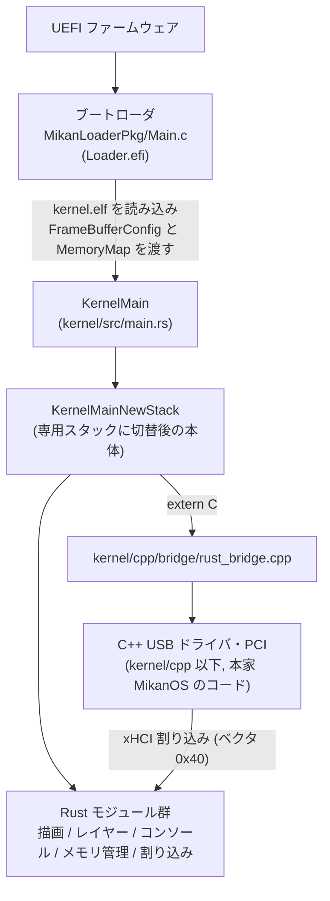
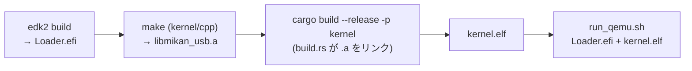
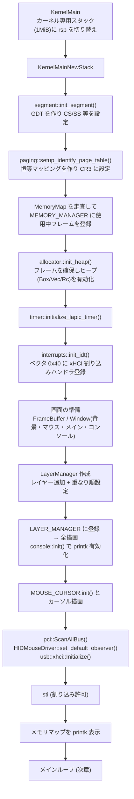
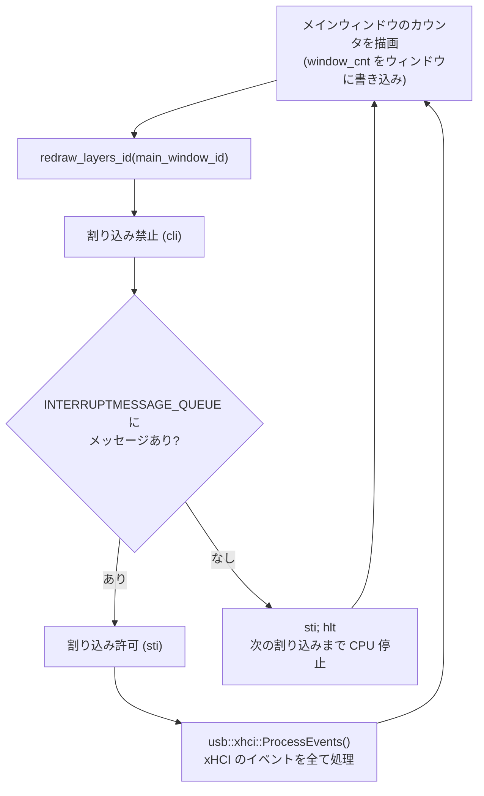
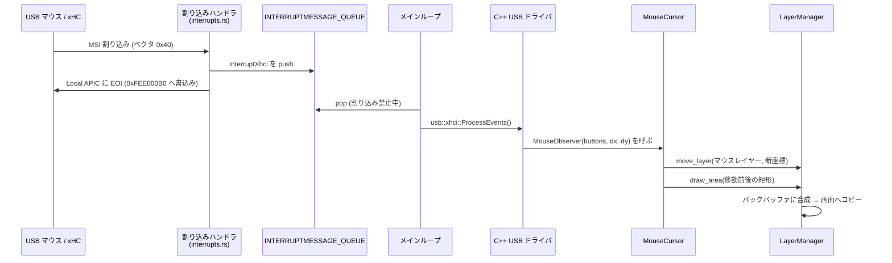
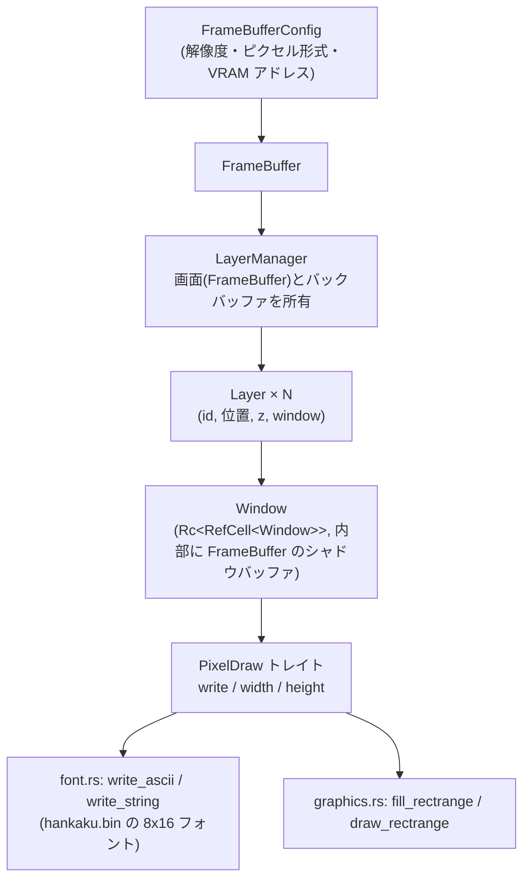
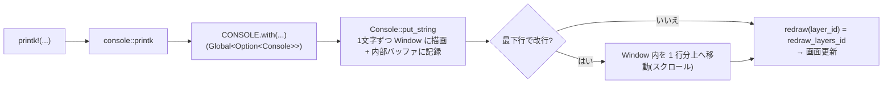
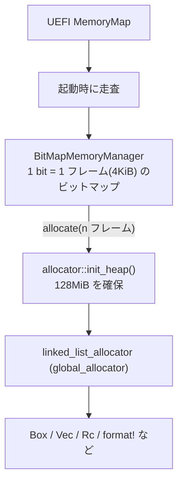
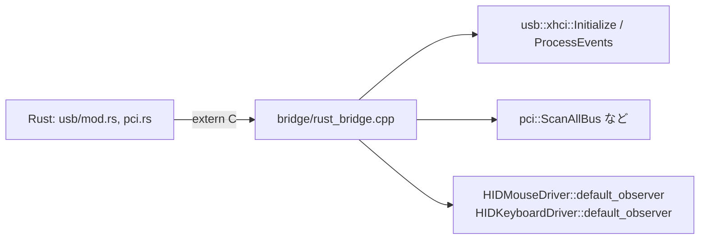
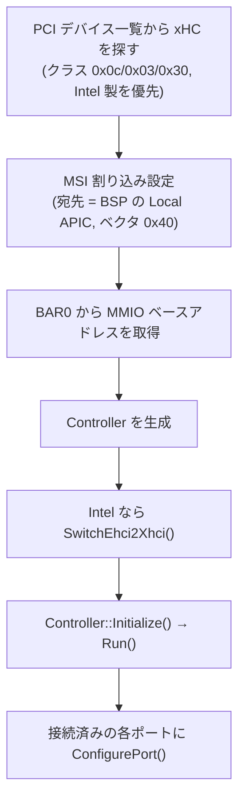

# mikanrustos カーネル 処理解説

MikanOS（osbook）を Rust で実装している OS カーネルの、現時点（osbook_day10e まで）の処理内容と流れの解説です。
図は Mermaid で書いています（GitHub / VS Code のプレビューで表示できます）。

---

## 1. 全体像



### ディレクトリ構成

| パス | 役割 |
|---|---|
| `MikanLoaderPkg/` | UEFI ブートローダ（C, edk2 でビルド） |
| `kernel/src/` | Rust 製カーネル本体 |
| `kernel/cpp/` | 本家 MikanOS 由来の C++ コード（USB ドライバ, PCI）。`make` で `libmikan_usb.a` になる |
| `kernel/cpp/usb/` | 本家の USB ドライバ（無改造） |
| `kernel/cpp/bridge/` | Rust から呼ぶための `extern "C"` 薄ラッパー |
| `kernel/build.rs` | `libmikan_usb.a` を Rust にリンクする設定 |
| `build_and_runOS.sh` | ローダ → C++ ライブラリ → Rust カーネル → QEMU 起動までを一括実行 |

### ビルドの流れ



---

## 2. 起動から定常動作までの流れ

`KernelMain` は C ABI のエントリポイントで、ブートローダから `FrameBufferConfig` と `MemoryMap` を受け取ります。



各ステップの内容:

1. **スタック切替** … ブートローダのスタックから、カーネル内の静的領域 `KERNEL_STACK` に切り替えます。
2. **GDT** … カーネル用コード/データセグメントを持つ GDT をロードし、セグメントレジスタを設定します。
3. **ページテーブル** … 64GiB を 2MiB ページで恒等マッピング（仮想アドレス＝物理アドレス）します。
4. **メモリマネージャ** … UEFI のメモリマップを読み、利用可能領域以外（隙間・予約領域）を「使用中」に印を付けます。
5. **ヒープ** … メモリマネージャから `64*512` フレーム（128MiB）を確保し、`linked_list_allocator` に渡します。以降 `Box`, `Vec`, `Rc` が使えます。
6. **IDT** … xHCI 割り込み（ベクタ `0x40`）のハンドラを登録します。
7. **画面構築** … 下の「描画の仕組み」参照。
8. **USB 初期化** … PCI 全探索 → マウスのコールバック登録 → xHC 探索・初期化・起動・接続済みポート設定。MSI 割り込みの設定もここで行われます。

---

## 3. メインループ（定常動作）



- キューの確認から `hlt` までの間に割り込みが入って取りこぼすのを防ぐため、**割り込み禁止のまま確認 → なければ `sti; hlt`**（`sti` 直後の 1 命令は割り込まれないので安全）という手順です。
- カウンタは割り込みで起こされるたびに増えます（`hlt` で止まっている間は増えません）。

### マウス操作が画面に反映されるまで



割り込みハンドラ内では**キューに積むだけ**で、重い処理（USB のイベント処理・描画）はメインループ側で行います。

---

## 4. 描画の仕組み

### 4.1 層構造



| モジュール | 内容 |
|---|---|
| `frame_buffer_config.rs` | ブートローダから渡される設定の型（`PixelFormat`: RGB / BGR） |
| `frame_buffer.rs` | `FrameBuffer`。VRAM または確保したバッファ。`copy_area`（矩形コピー）、`move`（領域移動）等 |
| `graphics.rs` | `PixelDraw` トレイト、`PixelColor`、`Vector2D`、`Rectangle`、矩形描画 |
| `font.rs` | `hankaku.bin` を使った文字描画。`write_ascii` / `write_string` |
| `window.rs` | `Window`（描画対象のバッファ。透明色 `set_transparent_color` 対応）、`draw_window`（タイトルバー付き枠の描画） |
| `layer.rs` | `Layer` / `LayerManager`。重なり順を管理して合成 |
| `console.rs` | 80×25 のテキストコンソール。`printk!` マクロの出力先 |
| `mousecursor.rs` | マウスカーソルの形状・位置管理 |

### 4.2 `LayerManager` の描画メソッド

| メソッド | 動作 |
|---|---|
| `draw_all()` | 重なり順（背面→前面）に全レイヤーを**直接画面へ**描画。 |
| `draw_area(area)` | 画面上の矩形 `area` だけを、各レイヤーから**バックバッファ**に合成してから画面へコピー（ちらつき防止）。 |
| `draw_id(id)` | レイヤー `id` の領域について、そのレイヤーと**前面側のレイヤー**を合成して画面へコピー。 |
| `up_down(id, z)` | 重なり順を設定（z が小さいほど背面、負で非表示）。 |
| `move_layer(id, pos)` | レイヤー位置を変更（再描画は呼び出し側で行う）。 |

現在のレイヤー構成（背面 → 前面）:

| z | レイヤー |
|---|---|
| 0 | 背景（デスクトップ） |
| 1 | コンソール |
| 2 | メインウィンドウ（"Hello window" とカウンタ） |
| 3 | マウスカーソル |

### 4.3 `printk!` の流れ



`Console` 初期化前（`console::init` 前）の `printk!` は無視されます。

---

## 5. メモリ管理



- `BitMapMemoryManager`（`memory_manager.rs`）: `allocate` は先頭から連続した空きフレームを探して確保、`free` で解放、`mark_allocated` で使用中を登録、`set_memory_range` で管理範囲を設定します。最大 128GiB まで管理できます。
- `FrameBuffer::new` は `frame_buffer` が null のときだけ `Vec` で領域を確保します（バックバッファ・ウィンドウ用）。VRAM は実アドレスをそのまま使います。

---

## 6. 割り込みと排他制御

| 項目 | 内容 |
|---|---|
| `interrupts.rs` | IDT の初期化。ベクタ `0x40`（xHCI）のハンドラが `INTERRUPTMESSAGE_QUEUE` に push し、EOI を書きます。 |
| `queue.rs` | 256 要素のリングバッファ `Queue<T>`（満杯なら push は失敗） |
| `timer.rs` | Local APIC タイマー（初期化・計測開始・経過取得・停止）。マウス移動処理の所要時間計測用 |
| `segment.rs` / `paging.rs` | GDT 設定 / 恒等ページテーブル |

### `Global<T>`（`global.rs`）

`static mut` の代わりに使うグローバル変数ラッパーです。

```rust
static COUNTER: Global<u32> = Global::new(0);
COUNTER.with(|c| *c += 1);
```

- `with` の間は**割り込みを禁止**（終了時に元の状態へ復帰）→ 割り込みハンドラとの競合を防止。
- 同じ `Global` に対する**再入はパニック**（`&mut` の重複を防ぐ）。
- シングルコア前提です。

主なグローバル変数:

| 変数 | 型 | 用途 |
|---|---|---|
| `MEMORY_MANAGER` | `Global<BitMapMemoryManager>` | フレーム管理 |
| `LAYER_MANAGER` | `Global<Option<LayerManager>>` | 画面合成 |
| `CONSOLE` | `Global<Option<Console>>` | `printk!` の出力先 |
| `MOUSE_CURSOR` | `Global<MouseCursor>` | カーソル位置・状態 |
| `INTERRUPTMESSAGE_QUEUE` | `Global<Queue<InterruptMessage>>` | 割り込み → メインループの通知 |
| `IDT` / `GDT` / ページテーブル | `Global<...>` | CPU が参照するテーブル |

> 注意: `with` の中から、同じ `Global` を使う処理（例: `CONSOLE.with` の中での `printk!`）を呼ぶと再入でパニックします。

---

## 7. USB（C++ ドライバの利用）

USB ドライバ本体は本家 MikanOS の C++ コードで、Rust からは**本家と同じ名前**で呼べます（`kernel/src/usb/mod.rs`, `kernel/src/pci.rs`）。

| 本家 (C++) | Rust |
|---|---|
| `pci::ScanAllBus()` | `pci::ScanAllBus()` |
| `usb::HIDMouseDriver::default_observer = f` | `usb::HIDMouseDriver::set_default_observer(f)` |
| `usb::HIDKeyboardDriver::default_observer = f` | `usb::HIDKeyboardDriver::set_default_observer(f)` |
| `usb::xhci::Initialize()` | `usb::xhci::Initialize()` |
| `usb::xhci::ProcessEvents()` | `usb::xhci::ProcessEvents()` |



`usb::xhci::Initialize()` の内部処理（C++ 側, `usb/xhci/xhci.cpp`）:



その後、マウスが動くたびに登録したコールバック（`mousecursor::MouseObserver`）が `(buttons, dx, dy)` で呼ばれ、カーソルが移動します。
C++ 側の `Log()` は何も出力しません（デバッグ出力は未接続）。

---

## 8. ファイル別 早見表

| ファイル | 主な内容 |
|---|---|
| `main.rs` | `KernelMain`（スタック切替）、`KernelMainNewStack`（初期化とメインループ）、`redraw_layers_*`、パニックハンドラ |
| `global.rs` | `Global<T>` |
| `segment.rs` | GDT 初期化 |
| `paging.rs` | 恒等マッピングのページテーブル設定 |
| `memory_map.rs` | UEFI メモリマップの型 (`MemoryMap`, `MemoryDescriptor`, `MemoryType`) |
| `memory_manager.rs` | ビットマップによるフレーム管理 |
| `allocator.rs` | ヒープの初期化と `#[global_allocator]` |
| `interrupts.rs` | IDT・xHCI 割り込みハンドラ・メッセージキュー |
| `queue.rs` | リングバッファ |
| `timer.rs` | Local APIC タイマー |
| `frame_buffer_config.rs` / `frame_buffer.rs` | 画面バッファ |
| `graphics.rs` / `font.rs` | 描画プリミティブ / フォント |
| `window.rs` / `layer.rs` | ウィンドウ / レイヤー合成 |
| `console.rs` | テキストコンソールと `printk!` |
| `mousecursor.rs` | マウスカーソル |
| `pci.rs` / `usb/mod.rs` | C++ の PCI / USB ドライバの Rust インターフェース |
